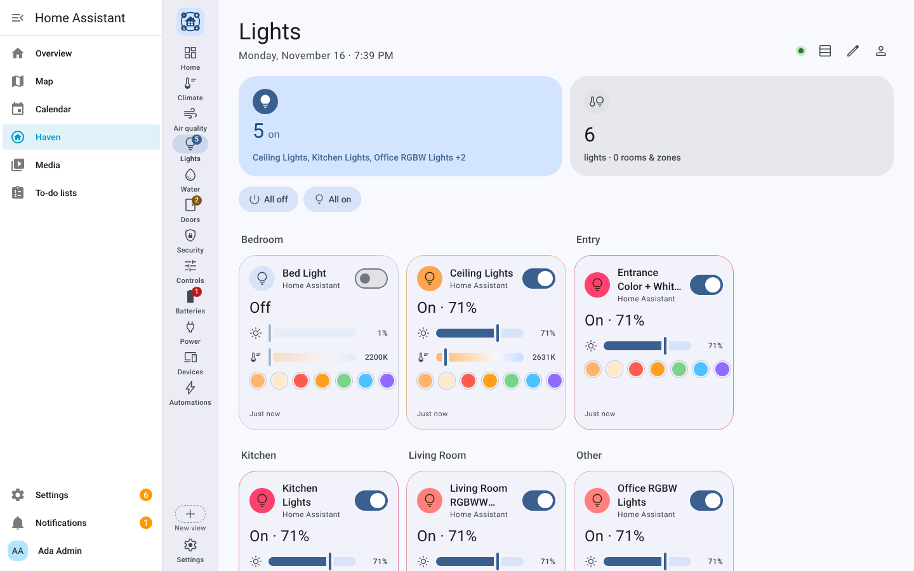

# Haven for Home Assistant

> **This repository is generated.** Every file here is built from [ryanbyte1701/haven](https://github.com/ryanbyte1701/haven)
> by `tools/hacs/build.py` (a GitHub Action does it every 30 minutes). Don't edit it by hand: changes are
> overwritten. Report problems and send changes to [ryanbyte1701/haven](https://github.com/ryanbyte1701/haven/issues).

Haven is a calm, self-hosted smart-home dashboard: rooms, climate, lights, doors, water, air quality,
batteries, power, history charts, a configurable home page and simple automations. This is **Haven as a Home
Assistant integration**: it adds a **Haven** item to Home Assistant's sidebar and shows **the devices you
already have in Home Assistant**, in their Home Assistant areas, and controls them through Home Assistant.

## Install (HACS)

1. In Home Assistant open **HACS → ⋮ (top right) → Custom repositories**.
2. Repository: `https://github.com/ryanbyte1701/haven-hacs`, Type: **Integration** → **Add**.
3. Search HACS for **Haven**, open it and **Download**. Restart Home Assistant.
4. **Settings → Devices & services → Add integration → Haven**. There is nothing to fill in.
5. **Haven** appears in the sidebar for everyone. Home Assistant administrators can change Haven's settings.

Requires Home Assistant 2026.3.0 or newer. HACS installs the Python package Haven needs (FastAPI) the first
time the integration starts; that needs internet access once.

## What you get

- Haven's whole dashboard inside Home Assistant (Home, Climate, Air quality, Lights, Water, Doors, Security,
  Controls, Batteries, Power, Devices, your own views, device pop-ups with history, Settings), with Home
  Assistant's sidebar still there. On a phone, Haven's own bottom bar works as usual.
- Every Home Assistant device, grouped by device and area (hidden, disabled, configuration and diagnostic
  entities are left out; battery levels are kept). New, renamed and moved devices show up by themselves.
  Settings → Home Assistant can limit Haven to some areas, entity types or skip entities.
- Sign-in is Home Assistant's: **administrators are Haven admins**, everyone else is a **Regular** user
  (sees and controls devices). No separate passwords.
- History (charts going back up to a year), layout, home page, automations and settings are kept in the
  **`haven` folder of your Home Assistant configuration**, so Home Assistant's backups include them.
- Light/dark: Haven's Appearance setting; "Auto" follows Home Assistant's theme.

## Haven for Home Assistant and Haven (Docker)

The same Haven also runs on its own as a Docker app ([ryanbyte1701/haven](https://github.com/ryanbyte1701/haven)),
with its own integrations (YoLink, Aqara, Ecowitt, Hue, Ring, ecobee, Tapo, MQTT, Matter, ...), user accounts,
backups and high availability. This edition leaves those out: Home Assistant already connects your devices,
keeps the time, signs people in and makes backups. Both editions are built from the same source, so dashboard
improvements arrive in both.

## Privacy

Haven runs entirely inside your Home Assistant. It connects to nothing on its own, only to what you set up
(an automation's webhook, a Prometheus server for history).

What changed in each version: [CHANGELOG.md](CHANGELOG.md) (also on each GitHub release).
